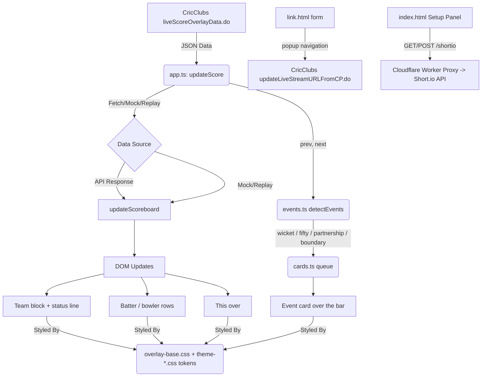

# System Architecture - Cricket Scorecard Overlay

The Cricket Scorecard Overlay is a lightweight, client-side web application designed to display real-time cricket scores during live broadcasts. It leverages the CricClubs API to fetch data, provides a customizable UI through a modular CSS theming system, includes a setup panel with Short.io integration, and provides a standalone utility (`link.html`) for linking a YouTube live stream to a CricClubs match. It is built with Vite + TypeScript, tested with Vitest, and deployed on GitHub Pages.

## Project Structure

```text
ScoreBanner2/
├── .github/workflows/
│   ├── ci.yml          # Typecheck, unit tests, and Vite build on PRs and pushes
│   └── deploy.yml      # Automated deployment of dist/ to GitHub Pages
├── src/
│   ├── assets/images/  # Sponsor logos, imported by config.ts so Vite bundles them
│   ├── script.ts       # Entry point: imports fonts/CSS, then starts pollLoop() in app.ts
│   ├── app.ts          # pollLoop() and updateScore() mode switch
│   ├── events.ts       # detectEvents(prev, next): wicket / milestone / partnership / boundary from poll diffs
│   ├── cards.ts        # Event card queue: copy, hold times, one-at-a-time playback, sample cards
│   ├── config.ts       # CONFIG constant (refresh rate, default club ID, logo map)
│   ├── types.ts        # CricketAPIData/CricketAPIValues interfaces modeling the CricClubs response
│   ├── dom.ts          # DOM element lookup map
│   ├── api.ts          # fetchScoreData() - fetches and parses the live score JSON
│   ├── ui.ts           # updateScoreboard()/updateBallByBall()/updateTeamLogos() - DOM updates
│   ├── theme.ts        # applyTheme()/updateLogo() - theme class + sponsor logo switching
│   ├── liveStream.ts   # linkLiveStream() - the Link Live Stream popup workflow
│   ├── utils.ts        # getQueryParams(), loadImage(), getBallStyleClass()
│   ├── mockData.ts     # Static match states for ?debug=1-5
│   ├── replayData.ts   # Sequence of match states for ?mode=replay
│   ├── *.test.ts       # Vitest unit tests
│   └── css/
│       ├── instructions.css   # Setup panel styling shared by index.html and link.html
│       ├── overlay-base.css   # The overlay layout, shared by every theme
│       └── theme-*.css        # One colour palette per theme (see Theming System below)
├── index.html          # Setup panel (URL builder + Short.io updater) & overlay DOM structure
├── link.html           # Standalone page to link a YouTube live stream to a CricClubs match
├── architecture.md     # This document
└── README.md           # Quick start and configuration guide
```

## Core Components

### 1. Data Polling Engine
Located in `src/app.ts` (started from `src/script.ts`), `updateScore()` runs once on load and then is re-scheduled with `setTimeout` *after* each run completes (`pollLoop()`), so a slow response can never overlap the next poll. On a failed fetch it keeps the last good frame on screen once at least one has rendered; before that it shows "Error" so a wrong `matchId` is visible during setup.
- **Refresh Rate**: `CONFIG.REFRESH_RATE`, default 5000ms.
- **Fetch Logic**: `fetchScoreData()` (`src/api.ts`) calls the CricClubs `liveScoreOverlayData.do` endpoint and parses the JSON response. This endpoint is public/CORS-open, so it works directly from any origin without credentials.
- **Mode branching**: `updateScore()` decides between showing `#setup-panel` (no `matchId`/`debug`/`mode=replay`), mock data (`?debug=1-5`, from `mockData.ts`), replay data (`?mode=replay`, cycling through `replayData.ts`), or a live fetch.

### 2. State Management & DOM Updates
- **DOM Mapping**: The `DOM` constant in `src/dom.ts` maps HTML IDs to typed element references for efficient, repeated updates.
- **Normalization**: `updateScoreboard()` (`src/ui.ts`) processes raw API data and updates text content, visibility, and styles, only touching the DOM when a value actually changes (via `setText`/`setDisplay` helpers) to avoid layout thrash. `statusText()` computes the context around the score: `CRR x.xx` at the end of the score row in the first innings; in a chase `Target n` on the score row and `Need n off o ov · RRR x.xx` on a third row.
- **Event cards**: `app.ts` keeps the previous frame and passes `(prev, next)` to `detectEvents()` (`src/events.ts`), a pure diff that yields wicket, fifty/hundred, partnership, and boundary events (`parseDismissal()` reduces CricClubs' HTML dismissal string to text). `enqueueCards()` (`src/cards.ts`) plays them one at a time over the batter/bowler slots with per-type hold times; `?quiet` disables them and `?debug=…&card=<type>` holds a sample.
- **Ball-by-Ball Tracking**: `updateBallByBall()` manages the history of the current over, injecting a styled indicator per delivery.
- **Team Logos**: `updateTeamLogos()` caches loaded logo images and only re-fetches when the URL changes.

### 3. Theming System
- **One layout, many palettes.** `src/css/overlay-base.css` holds the entire overlay layout, an ICC-style lower third: batting logo, brand-coloured team block (name, score, overs, status line), two batter rows, bowler row plus this-over balls, and bowling logo. Event cards slide in over the batter/bowler slots; the result card sits above the bar.
- **Themes are tokens.** Each `src/css/theme-<name>.css` sets colour custom properties on `.theme-<name>`. No theme file contains layout. `applyTheme()` (`src/theme.ts`) toggles the `theme-<name>` class on `<body>` and falls back to `modern-light` for unknown names (`modern` is an alias for it).
- **Available themes** (18): `orange`, `classic` (cream/navy), `modern-light` (default fallback), `modern-dark`, `neon`; the 10 IPL franchises `kkr`, `rcb`, `mi`, `csk`, `dc`, `rr`, `srh`, `pbks`, `gt`, `lsg`; and `topguns-light`, `topguns-dark` (legacy `tel`/`ted`/`tul`/`tud` names are aliases).

### 4. Setup Panel & Link Live Stream
When no `matchId`/`debug`/`mode=replay` is present, `index.html` shows `#setup-panel`:
- **Overlay Link Builder**: Match ID, Club ID (with `USACricketJunior` `40319` and `GPCL` `48` radio buttons plus custom input), theme selector grid (`orange` preselected), and an interactive **All URL parameters** table with checkboxes/selectors for every parameter.
- **Short.io Integration**: Fetches existing short links via the Cloudflare Worker proxy (`https://overlay.cricketoman.workers.dev/shortio`) and updates any selected short link's destination URL in one click.
- **Link Live Stream (`link.html`)**: Calls `linkLiveStream()` (`src/liveStream.ts`) to attach a YouTube URL to a CricClubs match via `updateLiveStreamURLFromCP.do` using a temporary top-level popup navigation.

## Data Flow


